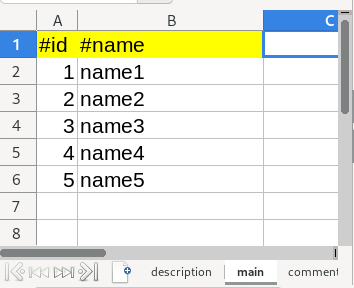
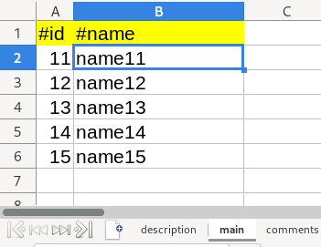
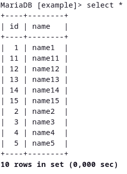
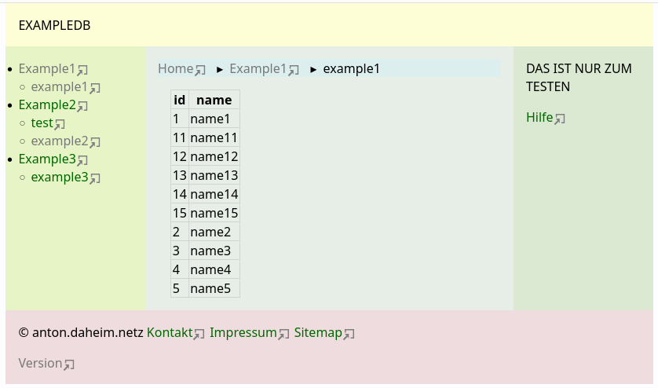
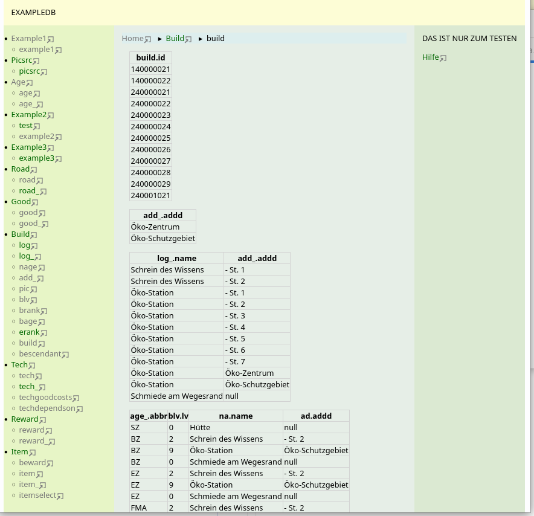

txt2db - ein Projekt der Moncastry Suite

[Version](Version.md)

[Lizenz](LICENSE)

[Beschreibung](Framework/help.md)

# Werbung

Erzeugt aus dieser **Textdatei**

```
###
###
  SELECT id, name FROM   example1;
###
1
###
  CREATE TABLE example1(id INT UNSIGNED   NOT NULL AUTO_INCREMENT  COMMENT ""
 , name VARCHAR(200) NOT NULL COMMENT "", PRIMARY KEY (id), UNIQUE (name));
###
  DROP TABLE IF EXISTS example1;
###
###
  LOAD DATA LOCAL INFILE "db/example1_main.csv" \
    INTO TABLE example1 FIELDS TERMINATED BY ";"; SHOW WARNINGS;
###
skip
1/1/2/2
```
und zwei **Ods Datei**en mit dem Inhalt





eine **Datenbanktabelle**



und eine **Webseite**




## Es kann natürlich viel komplizierter sein


